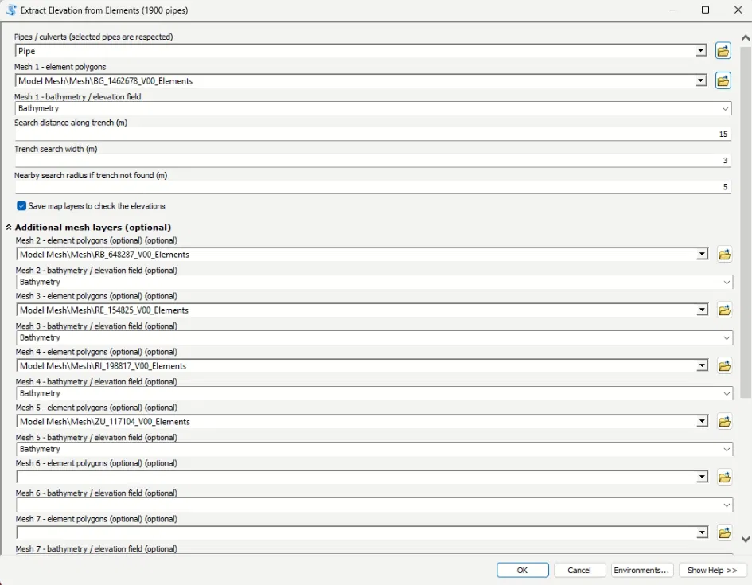
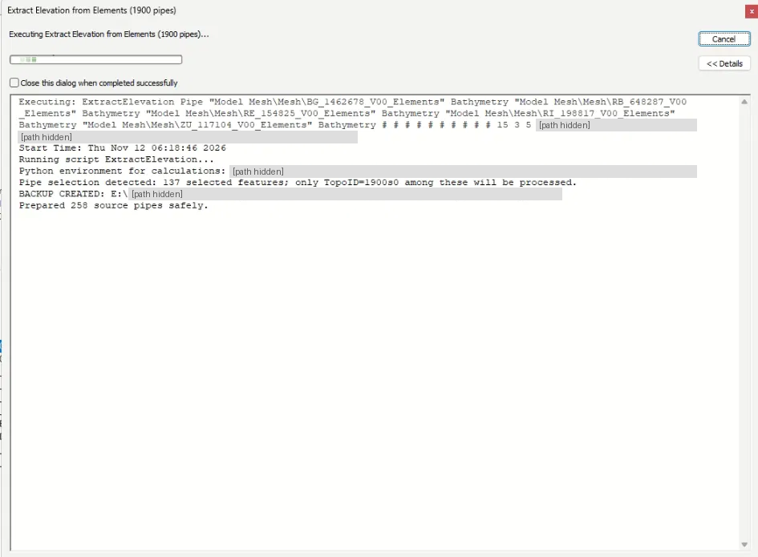
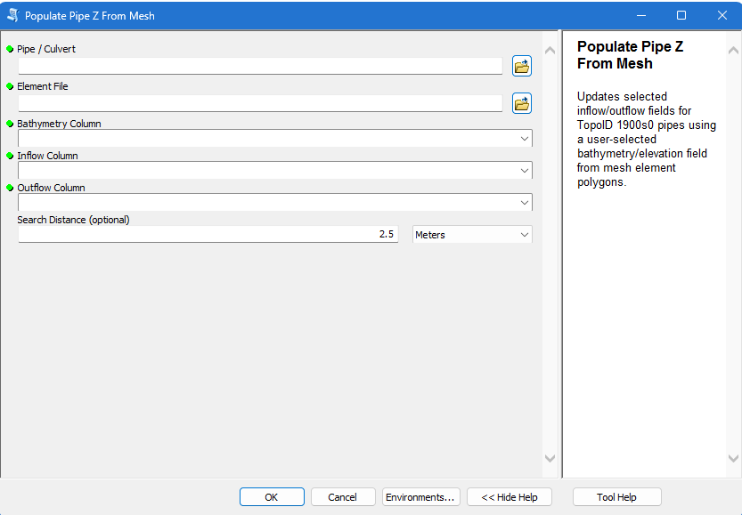

# Pipe Culvert Mesh Tools

Two ArcMap toolboxes that read mesh elevations and write pipe and culvert levels back to the pipe shapefile.

| Tool | Use it to |
| --- | --- |
| **[Extract Elevation from Elements (1900 pipes)](#extract-elevation-from-elements-1900-pipes)** | Fill `Z_Inflow` and `Z_Outflow` for `TopoID = 1900s0` pipes from up to 10 mesh layers. |
| **[Populate Pipe Z From Mesh](#populate-pipe-z-from-mesh)** | Fill inflow and outflow level fields from one mesh layer. |

---

## Extract Elevation from Elements (1900 pipes)

### What it does

For each pipe, the tool looks at the mesh cells around the **start** (inlet) and **end** (outlet) of the pipe. It then writes two numbers into the pipe shapefile:

- **`Z_Inflow`** – the lowest mesh elevation found at the inlet.
- **`Z_Outflow`** – the highest mesh elevation found at the outlet that is still **lower than the inflow**.

### How it works

1. **Pick pipes.** Only pipes with `TopoID = 1900s0` are used. If you select pipes in ArcMap and choose that same layer, only the selected ones are used.
2. **Back up first.** A dated copy of the pipe shapefile is saved next to the original (for example `Pipe_2026-11-12.shp`; a second run on the same day ends in `_2`).
3. **Read the meshes.** Each mesh shapefile is read directly, but only near the pipe ends, so large meshes stay fast.
4. **Follow the trench.** Starting at the inlet, the tool follows connected four-sided mesh cells **15 m** upstream, inside a **3 m**-wide strip. Pipe bends are allowed. The outlet is followed the same way, downstream.
5. **Pick the levels.** Inlet = lowest cell value in the strip. Outlet = highest cell value in the strip that is below the inlet value.
6. **Fallback.** If no strip can be followed, it searches all cells within **5 m** of the pipe end, including triangles.
7. **Write the result.** Only `Z_Inflow` and `Z_Outflow` are changed, and only after the calculation has finished without error. If no valid outlet is found, `Z_Outflow` is set to **0**, meaning "not found" and not a real level.

### Functions

- Works on the pipe selection or on all `1900s0` pipes.
- Up to **10 mesh layers**, each with its own elevation field.
- Adjustable search distance, trench width and fallback radius.
- Automatic dated backup before any change.
- Optional check layers (**Save map layers to check the elevations**) so you can review the paths in ArcMap.
- The heavy calculation runs in a separate Python 3 environment, so ArcMap's Python 2.7 stays untouched.

### Install

1. Download this repository and keep the `Extract_Elevation_from_Elements_1900_pipes` folder in a permanent place, such as `C:\GIS_Tools`.
2. Run `setup_environment.bat` once. It installs the Python 3 libraries into your user profile (it expects Python 3.10, 64-bit, at `C:\Python310`; edit the path in the file if yours is elsewhere). If it fails, run `CHECK_PYTHON_PC.bat` and read the report.
3. In ArcMap, choose **ArcToolbox → Add Toolbox** and select `Extract_Elevation_from_Elements_1900_pipes.pyt`.
4. Open **Extract Elevation from Elements (1900 pipes)**.

### Inputs

| Setting | Choose |
| --- | --- |
| **Pipes / culverts** | The pipe shapefile, or its layer (to respect a selection). Geodatabase pipes are not accepted. |
| **Mesh 1 – element polygons** and **elevation field** | The first mesh and its numeric elevation field. |
| **Mesh 2 … 10** (optional) | More meshes, each with its own elevation field. |
| **Search distance along trench** | Default 15 m. |
| **Trench search width** | Default 3 m in total. |
| **Nearby search radius** | Default 5 m, used when no strip is found. |
| **Save map layers to check the elevations** | Tick it to create check layers (slower). |

### Good to know

- Use a **projected** coordinate system in metres.
- Stop editing and close the pipe attribute table before running.
- Test on a few selected pipes first. A shapefile cannot be rolled back, so keep the backup files together if you need to restore.
- The strip search is a geometric estimate. Check the results at junctions and sharp bends. It does not prove hydraulic connection or pipe invert levels.

---

## Populate Pipe Z From Mesh

Fills pipe and culvert inflow and outflow levels from mesh polygon elevations. It uses ArcMap's built-in ArcPy, so nothing else needs installing.

**Install:** download the ZIP, then in ArcMap's **Catalog** window browse to `Pipe_Culvert_Mesh_Tools.pyt` and open **Populate Pipe Z From Mesh**.

| Parameter | Choose |
| --- | --- |
| **Pipe / Culvert** | A polyline layer with a `TopoID` field |
| **Element File** | Mesh polygons containing elevation values |
| **Bathymetry Column** | The mesh elevation field |
| **Inflow Column** | The pipe field to fill with inflow levels |
| **Outflow Column** | The pipe field to fill with outflow levels |
| **Search Distance** | Default **2.5 metres** |

**How it works:** only pipes with `TopoID = 1900s0` are processed. The first vertex is the inflow point and the last is the outflow point.

- **Inflow:** the lowest elevation from polygons touching the start point and polygons within the search distance behind it.
- **Outflow:** the lowest elevation touching the end point if it is below the inflow. Otherwise it searches in front of the end point for the lowest value below the inflow.
- **Update:** both levels are written only when inflow is higher than outflow. Other pipes stay unchanged.

This tool edits the existing pipe fields, so work on a copy if you need the original values. To process a subset, select pipes and choose that map layer in the dialog.
