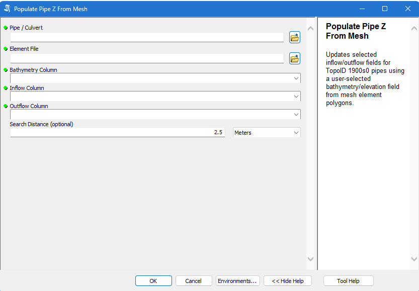

# Pipe Culvert Mesh Tool

An **ArcMap 10.8** toolbox that fills pipe and culvert inflow/outflow levels from mesh polygon elevations.

## Install and run

1. Click **Code → Download ZIP** and extract the files.
2. In ArcMap's **Catalog** window, browse to `Pipe_Culvert_Mesh_Tools.pyt`.
3. Open **Pipe Culvert Mesh Tools → Populate Pipe Z From Mesh**.
4. Choose your layers, fields and search distance, then run.

The toolbox uses ArcMap's built-in **ArcPy / Python 2.7**. No extra Python scripts or packages are needed.

## Inputs

| Parameter | Choose |
| --- | --- |
| **Pipe / Culvert** | A polyline layer with a `TopoID` field |
| **Element File** | Mesh polygons containing elevation values |
| **Bathymetry Column** | The mesh elevation field |
| **Inflow Column** | The pipe field to fill with inflow levels |
| **Outflow Column** | The pipe field to fill with outflow levels |
| **Search Distance** | Default **2.5 metres**; change it as needed |

Use numeric elevation fields with matching vertical units and datum. Both layers must have known coordinate systems; matching projected systems are recommended.

## How it works

Only pipes with **`TopoID = 1900s0`** are processed. The first vertex is the inflow/start point; the last vertex is the outflow/end point.

- **Inflow:** Uses the lowest elevation from polygons touching the start point and polygons within the search distance behind it.
- **Outflow:** Uses the lowest elevation touching the endpoint if it is below inflow. Otherwise, searches in front of the endpoint and takes the lowest value below inflow.
- **Update:** Writes both levels only when **inflow > outflow**. Pipes without suitable values remain unchanged. `TopoID` is preserved.

Behind and in front follow the pipe's digitized direction. ArcMap messages show updated and skipped counts.

**This tool edits the existing pipe fields. Use a copy if you need to keep the original values.** To process a subset, select pipes in ArcMap and choose that map layer in the dialog. Without a selection, all eligible pipes in the input layer are considered.
